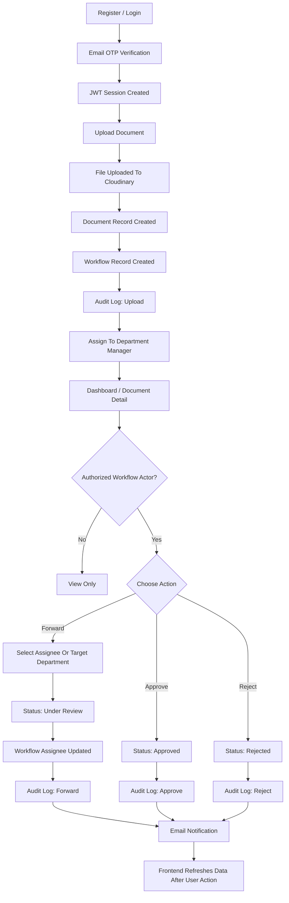

# TraceDoc

A full-stack document tracking application for uploading, reviewing, forwarding, approving, and rejecting documents across departments. The system supports role-based access, audit history, OTP-based login, Cloudinary file storage, and email notifications.

## Table of Contents

- [Overview](#overview)
- [Features](#features)
- [Tech Stack](#tech-stack)
- [Project Structure](#project-structure)
- [How The System Works](#how-the-system-works)
- [Workflow Diagram](#workflow-diagram)
- [Roles And Permissions](#roles-and-permissions)
- [Getting Started](#getting-started)
- [Environment Variables](#environment-variables)
- [Available Scripts](#available-scripts)
- [API Summary](#api-summary)
- [Useful Documentation](#useful-documentation)

## Overview

The Document Tracking System helps an organization manage documents from submission to final decision.

An employee can upload a document for a department. The backend creates a document record, creates a workflow record, assigns it to the relevant department manager when available, and records the action in the audit log. Managers and admins can then forward the document, approve it, reject it, add remarks, and update metadata based on their permissions.

The frontend provides pages for authentication, dashboard filtering, document upload, document detail review, workflow actions, document history, and admin user management.

## Features

- User registration and login with JWT authentication.
- Email OTP verification during login.
- Role-based access for `employee`, `manager`, and `admin`.
- Department-based document visibility and assignment.
- Upload documents with title, description, department, and file.
- Store uploaded files in Cloudinary.
- Track document status: `Submitted`, `Under Review`, `Approved`, `Rejected`.
- Forward documents to another user or department.
- Approve or reject documents with remarks.
- Maintain audit logs for workflow actions.
- Admin panel for user management.
- Dashboard filters for search, status, and department.
- Postman collection included for API testing.

## Tech Stack

### Frontend

- React 18
- Vite
- React Router
- Axios
- Redux Toolkit
- React Toastify
- Tailwind CSS

### Backend

- Node.js
- Express.js
- MongoDB
- Mongoose
- JWT
- bcryptjs
- Multer
- Cloudinary
- Nodemailer
- express-validator

## Project Structure

```text
Document-Tracking-System/
|-- README.md
|-- backend-docs.md
|-- workflow.md
|-- checklist.md
|-- postman/
|   `-- Document_Tracking_System.postman_collection.json
|-- backend/
|   |-- .env.example
|   |-- package.json
|   |-- server.js
|   |-- config/
|   |   |-- cloudinary.js
|   |   |-- db.js
|   |   `-- mail.js
|   |-- constants/
|   |   `-- departments.js
|   |-- controllers/
|   |   |-- authController.js
|   |   |-- documentController.js
|   |   |-- logController.js
|   |   |-- userController.js
|   |   `-- workflowController.js
|   |-- middleware/
|   |   |-- authMiddleware.js
|   |   |-- upload.js
|   |   `-- validation.js
|   |-- models/
|   |   |-- Document.js
|   |   |-- DocumentLog.js
|   |   |-- User.js
|   |   `-- Workflow.js
|   |-- routes/
|   |   |-- authRoutes.js
|   |   |-- documentRoutes.js
|   |   |-- logRoutes.js
|   |   |-- userRoutes.js
|   |   `-- workflowRoutes.js
|   |-- scripts/
|   |   `-- seedAdmin.js
|   `-- uploads/
|       `-- .gitkeep
`-- frontend/
    |-- package.json
    |-- vite.config.js
    |-- tailwind.config.js
    |-- postcss.config.js
    |-- index.html
    `-- src/
        |-- App.jsx
        |-- main.jsx
        |-- index.css
        |-- components/
        |   |-- Chatbot.jsx
        |   |-- Navbar.jsx
        |   |-- ProtectedRoute.jsx
        |   |-- Sidebar.jsx
        |   `-- StatusBadge.jsx
        |-- constants/
        |   `-- departments.js
        |-- context/
        |   `-- AuthContext.jsx
        |-- pages/
        |   |-- AdminPanel.jsx
        |   |-- Dashboard.jsx
        |   |-- DocumentDetail.jsx
        |   |-- Landing.jsx
        |   |-- Login.jsx
        |   |-- Register.jsx
        |   `-- UploadDocument.jsx
        |-- services/
        |   `-- api.js
        `-- store/
            |-- documentFiltersSlice.js
            `-- index.js
```

## How The System Works

1. A user registers with name, username, email, password, role, and department.
2. During login, the backend validates credentials and sends a 6-digit OTP to the user's email.
3. After OTP verification, the backend returns a JWT.
4. The frontend stores the JWT and sends it in the `Authorization` header for protected requests.
5. A user uploads a document with metadata and a file.
6. The backend uploads the file to Cloudinary and creates:
   - a `Document` record for document metadata,
   - a `Workflow` record for current stage and assignee,
   - a `DocumentLog` record for audit history.
7. The document is assigned to the manager of the selected department when a matching manager exists.
8. Authorized users can forward, approve, reject, or update the document.
9. Each workflow action updates the document, updates the workflow stage, writes an audit log, and sends relevant emails.
10. The frontend refreshes document data after user actions such as upload, metadata update, workflow submission, and navigation.

## Workflow Diagram



## Roles And Permissions

| Role | Main Access |
|---|---|
| `employee` | Upload documents, view documents they uploaded, and view documents assigned to them. |
| `manager` | View documents in their department, documents assigned to them, and documents they uploaded. Can act on authorized workflow items. |
| `admin` | Full access to documents, workflows, logs, and user management. |

## Departments

The system currently supports these departments:

- Human Resources
- Finance
- Operations
- Information Technology
- Legal
- Procurement
- Compliance

## Getting Started

### Prerequisites

- Node.js
- npm
- MongoDB
- Cloudinary account
- SMTP email account for OTP and notifications

### 1. Clone The Repository

```bash
git clone <repository-url>
cd Document-Tracking-System
```

### 2. Install Backend Dependencies

```bash
cd backend
npm install
```

### 3. Configure Backend Environment

Create `backend/.env` from `backend/.env.example`.

```bash
cp .env.example .env
```

Then update MongoDB, JWT, Cloudinary, and email values.

### 4. Install Frontend Dependencies

```bash
cd ../frontend
npm install
```

### 5. Configure Frontend Environment

For local development, `frontend/.env.development` can use:

```env
VITE_API_BASE_URL=/api
```

The Vite dev server proxies `/api` and `/uploads` to `http://localhost:5000`.

### 6. Seed Admin User

From the `backend` folder:

```bash
npm run seed:admin
```

Default admin values are used when environment variables are not provided:

```text
Email: admin@doctrack.com
Password: admin123
Username: system_admin
```

You can override these with `ADMIN_EMAIL`, `ADMIN_PASSWORD`, and `ADMIN_USERNAME` in `backend/.env`.

### 7. Run The Backend

From the `backend` folder:

```bash
npm run dev
```

Backend URL:

```text
http://localhost:5000
```

### 8. Run The Frontend

From the `frontend` folder:

```bash
npm run dev
```

Frontend URL:

```text
http://localhost:5173
```

## Environment Variables

### Backend

```env
PORT=5000
MONGO_URI=mongodb://localhost:27017/
JWT_SECRET=your_jwt_secret
JWT_EXPIRE=7d

CLOUDINARY_CLOUD_NAME=your_cloud_name
CLOUDINARY_API_KEY=your_api_key
CLOUDINARY_API_SECRET=your_api_secret

EMAIL_HOST=smtp.gmail.com
EMAIL_PORT=465
EMAIL_USER=your_email
EMAIL_PASS=your_email_app_password

FRONTEND_URL=http://localhost:5173
```

### Frontend

```env
VITE_API_BASE_URL=/api
```

Use a full backend URL in production if the frontend and backend are deployed separately:

```env
VITE_API_BASE_URL=https://your-api-domain.com/api
```

## Available Scripts

### Backend

| Command | Description |
|---|---|
| `npm run dev` | Start backend with nodemon. |
| `npm start` | Start backend with Node. |
| `npm run seed:admin` | Create the first admin account if one does not already exist. |

### Frontend

| Command | Description |
|---|---|
| `npm run dev` | Start Vite development server. |
| `npm run build` | Build the frontend for production. |
| `npm run preview` | Preview the production build locally. |

## API Summary

Base backend URL:

```text
http://localhost:5000
```

Protected routes require:

```http
Authorization: Bearer <token>
```

### Auth

| Method | Endpoint | Description |
|---|---|---|
| `POST` | `/api/auth/register` | Register a new user. |
| `POST` | `/api/auth/login` | Validate credentials and send OTP. |
| `POST` | `/api/auth/verify-otp` | Verify OTP and receive JWT. |
| `GET` | `/api/auth/profile` | Get current logged-in user. |
| `GET` | `/api/auth/users` | Get all users. Admin only. |

### Users

| Method | Endpoint | Description |
|---|---|---|
| `GET` | `/api/users/assignable` | Get users who can be assigned workflow items. |
| `GET` | `/api/users` | Get all users. Admin only. |
| `GET` | `/api/users/:id` | Get one user. Admin only. |
| `PUT` | `/api/users/:id` | Update user. Admin only. |
| `DELETE` | `/api/users/:id` | Delete user. Admin only. |

### Documents

| Method | Endpoint | Description |
|---|---|---|
| `POST` | `/api/documents` | Upload a document. |
| `GET` | `/api/documents` | List visible documents. Supports `search`, `status`, and `department` query filters. |
| `GET` | `/api/documents/:id` | Get one document with workflow details. |
| `PUT` | `/api/documents/:id` | Update document metadata, remarks, department, or file. |
| `DELETE` | `/api/documents/:id` | Delete a document. Owner or admin only. |
| `GET` | `/api/documents/:docId/logs` | Get audit history for a document. |

### Workflow

| Method | Endpoint | Description |
|---|---|---|
| `GET` | `/api/workflow/:documentId` | Get workflow details for a document. |
| `PUT` | `/api/workflow/:documentId` | Perform `Forward`, `Approve`, or `Reject`. |

### Logs

| Method | Endpoint | Description |
|---|---|---|
| `GET` | `/api/logs/:documentId` | Get logs for a document. |

## Data Models

### User

Stores account identity, authentication data, role, department, and temporary OTP fields.

### Document

Stores title, description, file URL, Cloudinary public ID, uploader, department, status, remarks, and timestamps.

### Workflow

Stores the document ID, current stage, current assignee, and timestamps.

### DocumentLog

Stores document history entries, including document ID, actor, action, and timestamp.

## File Upload Rules

- Upload field name must be `file`.
- Supported formats are handled by the backend upload middleware.
- Maximum file size is 5 MB.
- Files are uploaded to Cloudinary under the `document_tracking` folder.

## Data Refresh

The frontend uses REST API calls to load documents, workflow details, audit logs, and user data. After actions such as upload, metadata update, workflow submission, or delete, the relevant page requests fresh data from the backend.

## Useful Documentation

- Detailed backend endpoint docs: [backend-docs.md](backend-docs.md)
- Detailed workflow notes: [workflow.md](workflow.md)
- Postman collection: [postman/Document_Tracking_System.postman_collection.json](postman/Document_Tracking_System.postman_collection.json)
